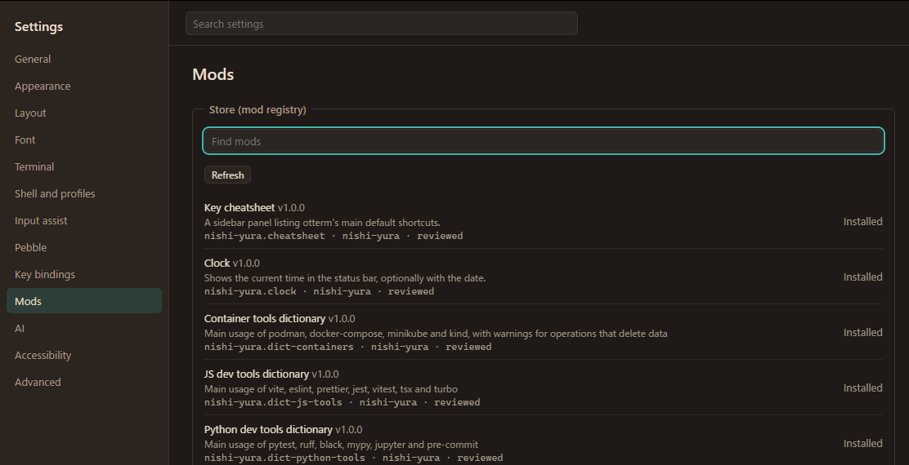
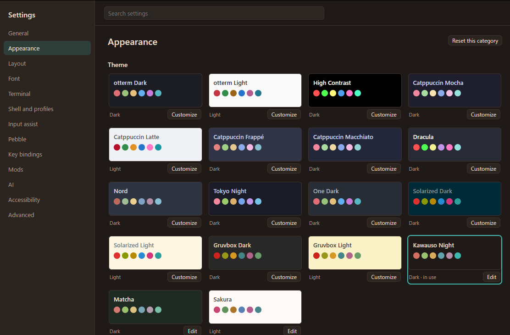
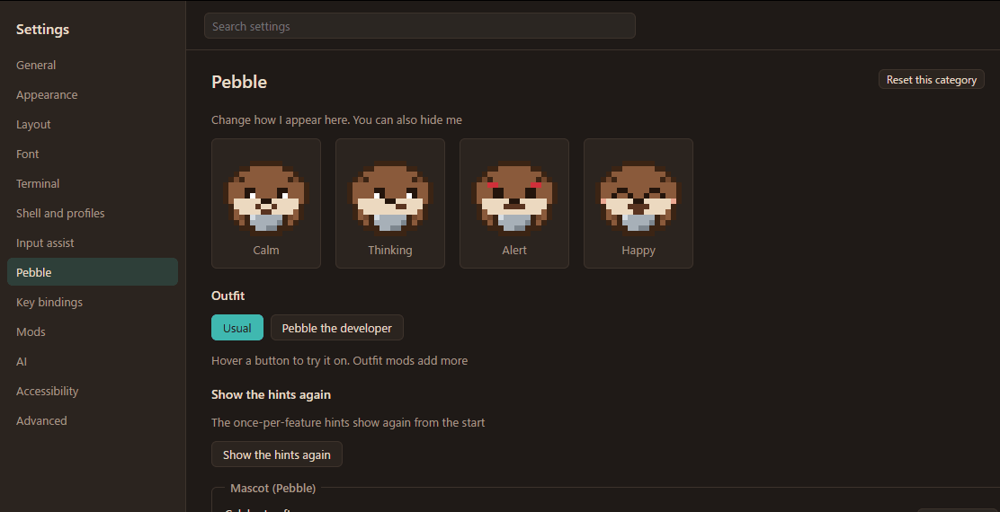

<div align="center">

<b>English</b> ・ <a href="README.md">日本語</a>


<br>

<a href="https://github.com/Nishi-Yura/Otterm/releases/latest"></a>
<a href="LICENSE"></a>

<br>


<h3>A friendly app instead of a black screen.<br>A light, fast tool you can reshape without limit, for people who live in a terminal.</h3>

<a href="#-install"><b>Install</b></a> ・
<a href="#-features"><b>Features</b></a> ・
<a href="#-pebble"><b>Pebble</b></a> ・
<a href="#-mods"><b>Mods</b></a> ・
<a href="#-performance"><b>Performance</b></a> ・
<a href="#-documentation"><b>Docs</b></a>

<br><br>

<picture>
  <source media="(prefers-color-scheme: light)" srcset="assets/readme/shot-light-en.png">
  
</picture>

<sub>The Kawauso Night theme (Sakura if you view this page in light mode). The otter in the corner is Pebble.</sub>

</div>

<br>

## 🦦 What is otterm?

The name is **otter + term**. Otters pry shells open with their nimble paws; otterm cracks the shell open for you.

- **For someone opening a terminal for the first time**, it explains the command *while you type it*, stops dangerous commands *before they run* and shows what would happen.
- **For someone who lives in a terminal**, set the guide level to **0** and it gets out of the way: GPU rendering, blocks, splits, search, the Kitty keyboard protocol.
- **Like a game, it takes mods.** Install one and something changes: a theme, a status bar item, a panel, a new outfit for Pebble. The built-in features use the same mod API.

> [!NOTE]
> otterm **never runs a command for you**. Suggestions go into the input line; you are always the one who presses Enter.

<br>

## ✨ Features

<table>
<tr>
<td width="50%" valign="top">

### 🧭 Understand as you type
The command you are typing is read against a dictionary (**164 commands** bundled, more through mods) and its options are explained above the input line. PowerShell `Verb-Noun` cmdlets and `git` subcommands included.

</td>
<td width="50%" valign="top">


</td>
</tr>
<tr>
<td width="50%" valign="top">


</td>
<td width="50%" valign="top">

### 🛑 A pause before the dangerous ones
`rm -rf`, `git push --force`, `docker volume prune`… Right before they run, otterm shows **what would be lost** and **a safer way**, and asks. The guide level sets how strict it is.

</td>
</tr>
<tr>
<td width="50%" valign="top">

### 🤖 Ask Pebble (AI, optional)
Off by default. Use a local model such as Ollama, or your own key (Claude, OpenAI, Gemini or any compatible API). **You see what is sent before it goes**, and anything that looks like a token or password is masked. Suggested commands only fill the input line.

</td>
<td width="50%" valign="top">


</td>
</tr>
<tr>
<td width="50%" valign="top">



</td>
<td width="50%" valign="top">

### 🧩 Mod store
Themes, status bar items, a clock, a pomodoro timer, a cheat sheet, more dictionaries… Install from the settings and they are on at once. Mods **declare their permissions**, run sandboxed and cannot take the terminal down.

</td>
</tr>
</table>

<details>
<summary><b>Everything else (click to open)</b></summary>

<br>

| | |
| --- | --- |
| 🧱 **Blocks** | Shell integration (OSC 133): fold, re-run, copy the output of, and jump between commands. pwsh, bash, zsh, fish |
| 🪟 **Tabs and splits** | Tabs, splits in both directions, workspaces (per-project settings and tabs in `.otterm/`, only once you trust the folder) |
| 🔎 **Search and scrollback** | Old lines are kept LZ4-compressed; with unlimited scrollback they move to disk, and search still reaches them |
| 🔗 **Links** | Ctrl+click URLs and file paths; drop files to type their paths |
| 🈁 **Japanese and more** | IME, wide characters, ligatures, emoji. The UI and Pebble speak English and Japanese |
| 🎨 **Themes** | 15 bundled, more as mods. Imports iTerm2, Windows Terminal, VS Code, Alacritty and WezTerm schemes. Background images, opacity, blur |
| ⌨️ **Key bindings** | Key sequences, `when` conditions, a command palette, record a key in the settings |
| ⚙️ **Settings** | `config.toml` and the settings screen are the same thing; a change in either applies at once |
| 🔄 **Updates** | Signed auto-updates (checking is opt-in). Local crash logs with a "file an issue" button |
| 🛡️ **Privacy** | No telemetry, no server, no account |

</details>

<p align="center">
  
  
</p>
<p align="center"><sub>15 bundled themes plus mods · Pebble's moods and outfits, tried on with a hover</sub></p>

<br>

## 🦦 Pebble


A small-clawed otter named **Pebble** (コツメ, Kotsume, in Japanese) lives in the window.

- **Thinking** while a long command runs, **happy** when it succeeds, **alert** when something is risky. The mood follows your work.
- A short word the first time you do something, and never the same thing twice.
- Outfit mods change the look (bundled: the developer set 👓☕).
- If you would rather not, one setting hides Pebble completely.

<br clear="right">

<p align="center">
  
</p>

<br>

## 🧩 Mods

```toml
# otmod.toml — this is a whole mod
[mod]
id = "you.hello"
name = "Hello"
version = "1.0.0"
author = "you"
kind = "extension"

[compat]
otterm = ">=1.0.0 <2.0.0"
api = "1"

[entry]
main = "dist/main.js"

[[adds]]
slot = "statusbar.right"
label = "A greeting"
```

```ts
// src/main.ts
import type { ModContext } from "@otterm/api";

export async function activate(ctx: ModContext) {
  ctx.ui.slot("statusbar.right").add({ type: "text", text: "🦦 hello" });
}
```

- **A typed API** ([`@otterm/api`](packages/api/), MIT) and a template ([`packages/create-mod`](packages/create-mod/))
- **Declared permissions.** Files, network, writing to the terminal, AI: the user sees them before installing
- **A QuickJS sandbox**, so a stuck mod never freezes the terminal
- Publish with a pull request to [registry/](registry/README.md). It costs nothing

| In the store | |
| --- | --- |
| 🎨 Themes | Kawauso Night, Sakura, Matcha, Yuki, Yuyake, Shinkai |
| 📊 Status bar | Git status, clock, pomodoro, exit code and duration |
| 🗂️ Panels | Project scripts (package.json / justfile / Makefile), folder bookmarks, command stats, key cheat sheet |
| 📚 Dictionaries | Containers, JavaScript tools, Python tools, network tools, database clients, modern CLI tools, media tools |
| 🦦 Pebble | Winter outfit (knit hat and mittens), command of the day |
| 🔔 Other | Done notifications for long commands |

<br>

## ⚡ Performance

From key press to the character on screen, measured by the benchmarks ([docs/bench](docs/bench/baseline.md); development machine, Ryzen 7 3700X, Windows).

| Metric | Value |
| --- | --- |
| ⌨️ Typing latency p99 (WebGL2) | **6.2 ms** (under half of a 16.7 ms frame) |
| 🚀 Launch to prompt (median) | **694 ms** |
| 📜 VT parsing | **62 MiB/s** |
| 🧠 Scrollback | Old lines LZ4-compressed, at most 32 MB in memory |

Keystrokes go straight to Rust and never wait for a mod. Rendering is WebGL2 (Canvas 2D as a fallback); glyphs are rasterized in Rust and packed into a texture.

<br>

## 📦 Install

v1.0 is for **Windows (x64)**. macOS and Linux builds follow in 1.0.x once they have been checked on real machines; until then, build from source.

| OS | How |
| --- | --- |
| 🪟 **Windows** | Run `otterm_<version>_x64-setup.exe` from [Releases](https://github.com/Nishi-Yura/Otterm/releases/latest) (per-user, no admin rights). Then `otterm` works in a new terminal. winget (`winget install otterm`) is pending |
| 🍎 **macOS** | A `.dmg` and a Homebrew tap (`brew install --cask nishi-yura/otterm/otterm`) in 1.0.x. From source for now |
| 🐧 **Linux** | An `.AppImage` in 1.0.x. From source for now |

> [!NOTE]
> The installer is not code-signed (certificates cost money). On Windows, SmartScreen needs "More info → Run anyway". `SHA256SUMS.txt` next to the installer lets you check the file. Updates are signed; the first-run guide asks whether otterm may check for them.

**From source**:

```bash
git clone https://github.com/Nishi-Yura/Otterm.git
cd Otterm
just setup   # JS dependencies and, on Windows, the bundled ConPTY
just dev     # run with hot reload
```

You need Rust (stable), Node.js 22+, pnpm and [just](https://github.com/casey/just); on Linux also the [Tauri prerequisites](https://v2.tauri.app/start/prerequisites/). To build an installer, run `node scripts/release.mjs` ([docs/release.md](docs/release.md), in Japanese).

<br>

## 🗺️ Roadmap

| | Milestone | |
| :-: | --- | --- |
| ✅ | M0 Foundations | Monorepo, benchmarks, CI |
| ✅ | M1 A working terminal | VT, tabs and splits, search, IME, WebGL2 |
| ✅ | M2 Shell integration and blocks | OSC 133, blocks, prompt bar |
| ✅ | M3 Mod system | Manifests, permissions, sandbox |
| ✅ | M4 Input assist | Dictionary, explanations, danger guard, completion |
| ✅ | M4.5 Pebble | Moods, lines, outfits |
| ✅ | M5 Settings and themes | Settings screen, key bindings, workspaces |
| ✅ | M5.5 AI assist | Local or your own key, preview of what is sent |
| ✅ | M6 Distribution | Installer, signed auto-update, store, documentation site |
| ✅ | v1.0 | Released for Windows |
| ⏳ | v1.0.x | macOS and Linux builds, winget and Homebrew, measurements on the reference machine |

Details: [docs/07-roadmap.md](docs/07-roadmap.md).

<br>

## 📚 Documentation

The user and mod author guides live in [site/](site/) (Starlight; not hosted yet, so read them on GitHub or run `pnpm --filter @otterm/site dev`).

- 🧭 [User guide](site/src/content/docs/en/guide/getting-started.md): install, basics, input assist, settings, key bindings, themes, Pebble, troubleshooting
- 🧩 [Mod author guide](site/src/content/docs/en/mods/index.md): writing a mod, the manifest, permissions, the API, packaging, publishing

The specification is written in Japanese and is the source of truth.

| | File | About |
| --- | --- | --- |
| 🌱 | [00-overview](docs/00-overview.md) | Concept, audience, non-goals |
| 📋 | [01-requirements](docs/01-requirements.md) | Functional and non-functional requirements |
| 🏗️ | [02-architecture](docs/02-architecture.md) | Stack and processes |
| 🧰 | [03-core-features](docs/03-core-features.md) | PTY, input assist, files, palette |
| 🎨 | [04-ui-theme](docs/04-ui-theme.md) | Layout and themes |
| 🧩 | [05-mod-system](docs/05-mod-system.md) | Manifest, API, permissions, distribution |
| ⚙️ | [06-config-keybind](docs/06-config-keybind.md) | Config file and key bindings |
| 🗺️ | [07-roadmap](docs/07-roadmap.md) | Milestones |
| 🦦 | [08-character](docs/08-character.md) | Pebble: design, moods, outfits |
| ⚡ | [09-performance](docs/09-performance.md) | Latency budget, renderers, benchmarks |
| 🤖 | [10-ai-assist](docs/10-ai-assist.md) | AI assist and what is sent |
| 🧭 | [11-decisions](docs/11-decisions.md) | Decision log |
| 🎛️ | [12-design-system](docs/12-design-system.md) | UI tokens, type, icons |

<br>

## 🤝 Contributing

Issues and pull requests are welcome. Start with [CONTRIBUTING.md](CONTRIBUTING.md). Code, comments, commit messages and issues are in English.

<br>

## 📄 License

- otterm: [Apache-2.0](LICENSE)
- Mod SDK (`@otterm/api`): MIT
- Pebble's artwork: character guideline ([assets/mascot/LICENSE.md](assets/mascot/LICENSE.md))

<br>

<div align="center">

<br>
<sub>No telemetry. No server. No account. Your terminal is yours.</sub>
</div>
