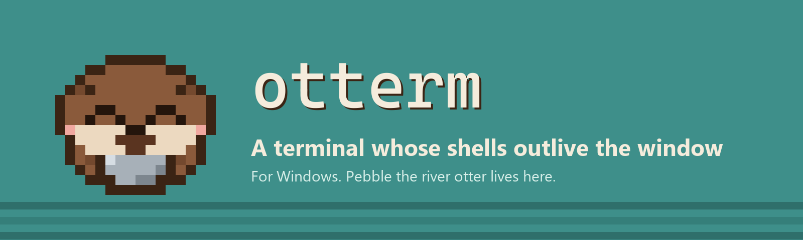
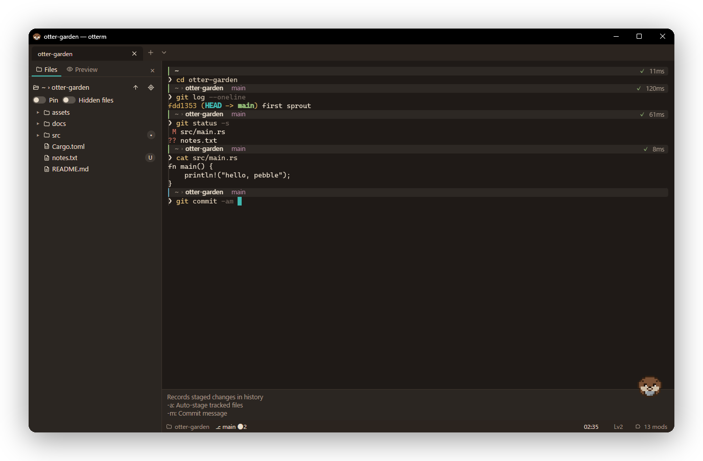
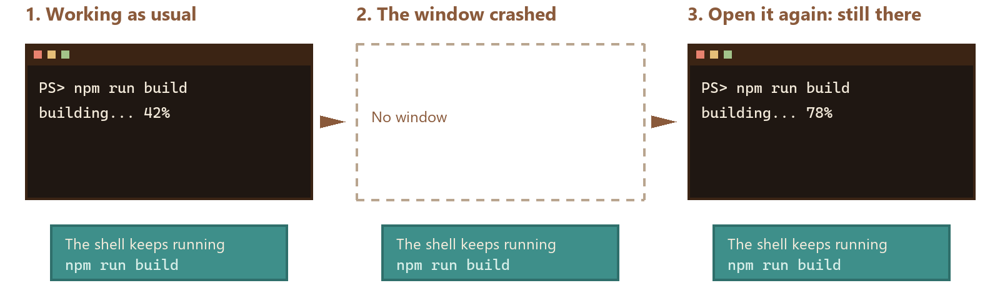
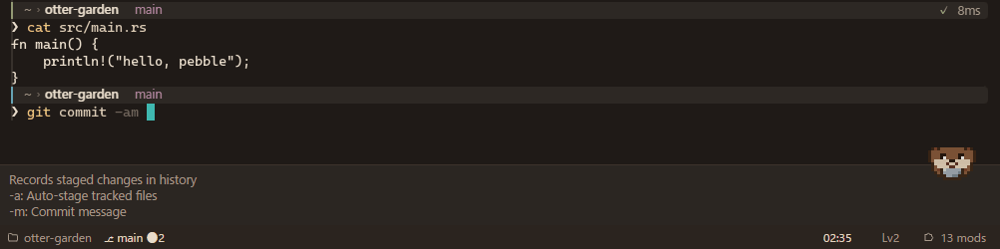
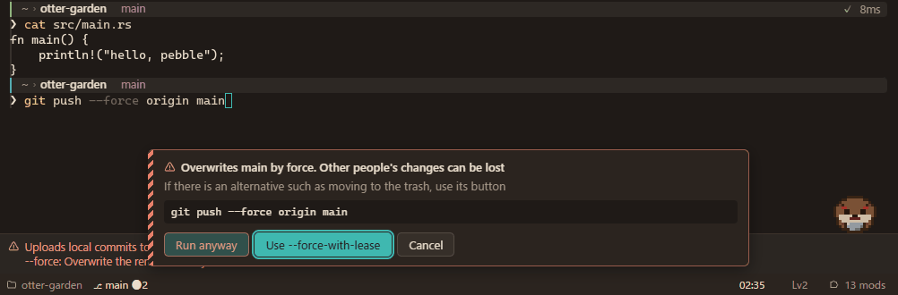
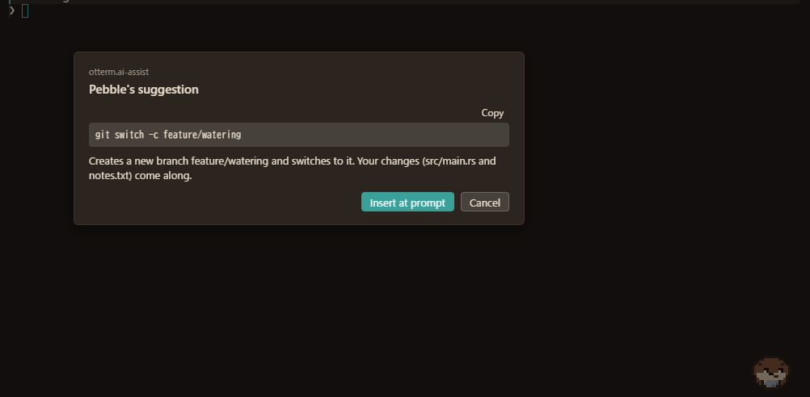
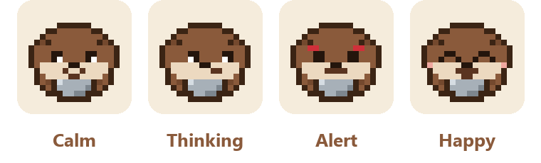

<div align="center">

<b>English</b> ・ <a href="README.md">日本語</a>



<a href="https://github.com/Nishi-Yura/Otterm/releases/latest"></a>
<a href="LICENSE"></a>


<br>

[Install](#install) ・ [How it differs](#how-it-differs) ・ [Mods](#add-what-you-want-with-mods) ・ [Pebble](#pebble) ・ [Performance](#performance) ・ [Docs](#docs)

<br>

<picture>
  <source media="(prefers-color-scheme: light)" srcset="assets/readme/shot-light-en.png">
  
</picture>

<sub>The theme is Kawauso Night (Sakura if you view GitHub in light mode). Pebble sits in the lower right. Both are mods.</sub>

</div>

<br>

## About otterm

otterm is a terminal built with Rust and Tauri. It ships for Windows today; macOS and Linux follow once they have been checked on real machines.

The name is "otter" plus "term". Otters crack shellfish open with a stone, so: a terminal that cracks the shell open.

What sets it apart most is that **your shells run in a process of their own, apart from the window**. If otterm crashes, or restarts for an update, your build or server keeps running, and the next window opens the same tabs again. No tmux needed, on Windows either.

<p align="center">
  
</p>

A fresh install is a plain terminal with nothing added. Pebble, the explanations as you type and the file tree are all mods, and you turn on only the ones you want.

> [!NOTE]
> otterm never runs a command for you. Suggestions only fill the input line; you press Enter.

<br>

## How it differs

In October 2026 we compared the terminals people use most. How we checked, and the sources, are in [docs/13-positioning.md](docs/13-positioning.md) (in Japanese).

| | otterm | Windows Terminal | WezTerm | Ghostty | Alacritty |
| --- | :-: | :-: | :-: | :-: | :-: |
| Runs on Windows | yes | yes | yes | no | yes |
| Shells survive a crashed window | yes | no | with its multiplexer | no | with tmux |
| Tabs and splits | yes | yes | yes | yes | no |
| Extensions | mods with declared permissions, sandboxed | extensions (since 1.25) | Lua, unrestricted | none | none |
| Japanese interface | yes | yes | no | no | no interface |

Where otterm is behind: it cannot show images yet (sixel, the kitty graphics protocol). There are no macOS or Linux builds yet. On a long scrolling output it parses a little over twice as fast as 1.1, but still slower than Ghostty or kitty (see [Performance](#performance)).

<br>

## Add what you want with mods

Turn mods on in Settings › Mods (the "mod" item in the status bar). "Turn on the recommended set" adds Pebble, the dictionary, explanations, completion, the danger guard, error hints, history search and the file tree in one step.

<table>
<tr>
<td width="50%" valign="top">

</td>
<td width="50%" valign="top">

### Explanations as you type

otterm reads the command you are typing with its bundled dictionary (164 commands) and shows what each option means above the input line. PowerShell's `Verb-Noun` names and `git` subcommands are in there. Mods can add more.

</td>
</tr>
<tr>
<td width="50%" valign="top">

### A pause before dangerous commands

`rm -rf`, `git push --force`, `docker volume prune`. Right before one of these runs, otterm shows what would be lost and a safer way to do it, and asks. The guide level sets how strict it is.

</td>
<td width="50%" valign="top">

</td>
</tr>
<tr>
<td width="50%" valign="top">

</td>
<td width="50%" valign="top">

### Asking an AI (if you want to)

Off by default. It uses a local model through Ollama, or your own API key (Claude, OpenAI, Gemini or a compatible API). Each time, you see what will be sent first; strings that look like tokens or passwords are masked. A command that comes back only goes into the input line.

</td>
</tr>
</table>

The store also has mods made by other people.

| Kind | In the store now |
| --- | --- |
| Themes | Kawauso Night, Sakura, Matcha, Yuki, Yuyake, Shinkai |
| Status bar | Git status, a clock, a pomodoro timer, exit code and duration |
| Panels | Project scripts (package.json, justfile, Makefile), folder bookmarks, command stats, a key cheat sheet |
| Dictionaries | Containers, JavaScript and Python tools, networking, databases, modern CLI tools, video and image conversion |
| Pebble | A winter outfit (knit hat and mittens), a command of the day |
| Other | A notice when a long command finishes |

<details>
<summary><b>Making a mod</b></summary>

<br>

A mod is an `otmod.toml` and one JavaScript file.

```toml
# otmod.toml
[mod]
id = "you.hello"
name = "Hello"
version = "1.0.0"
author = "you"
kind = "extension"

[compat]
otterm = ">=1.0.0 <2.0.0"
api = "1"

[entry]
main = "dist/main.js"

[[adds]]
slot = "statusbar.right"
label = "Greeting"
```

```ts
// src/main.ts
import type { ModContext } from "@otterm/api";

export async function activate(ctx: ModContext) {
  ctx.ui.slot("statusbar.right").add({ type: "text", text: "hello" });
}
```

- The API is typed ([`@otterm/api`](packages/api/), MIT). The template is in [`packages/create-mod`](packages/create-mod/).
- A mod that uses files, the network, writing to the terminal or AI says so before it is installed.
- Mods run in a QuickJS sandbox, so a stuck mod cannot freeze the terminal.
- Publishing to the store is a pull request to [registry/](registry/README.md). It costs nothing.

</details>

<br>

## Pebble


Pebble is a small-clawed otter (コツメ, Kotsume, in Japanese) who sits in a corner of the window. While a long command runs, Pebble thinks; when it succeeds, Pebble is happy; when something is risky, Pebble looks worried. Pebble says a short word only the first time you do something, and never the same thing twice.

The pixel art is placed by hand on a 16 by 16 grid. Outfits are mods too; the bundled one is a developer set with glasses and a mug. Pebble is a mod as well (`otterm.mascot`), so Pebble appears only once you turn it on.

<br clear="right">

<p align="center">
  
</p>

<br>

## Other things it does

| | |
| --- | --- |
| Blocks | With shell integration (OSC 133), each command can be folded, run again, have its output copied, and jumped to. pwsh, bash, zsh, fish |
| Tabs and splits | Tabs, vertical and horizontal splits, workspaces (`.otterm/` holds per-project settings and tabs; trusted ones only) |
| Search and scrollback | Old lines are kept LZ4-compressed. With unlimited scrollback they move to disk, and search still reaches them |
| Links | Ctrl+click URLs and file paths. Drop a file to type its path |
| Japanese | IME, full-width characters, ligatures, emoji. The interface and Pebble's lines are in Japanese and English |
| Themes | 15 bundled plus mods. Imports color schemes from iTerm2, Windows Terminal, VS Code, Alacritty and WezTerm |
| Key bindings | Key sequences, `when` conditions, a command palette, recording a key in the settings screen |
| Settings | `config.toml` and the settings screen are the same thing; a change in either applies at once |
| Updates | Signed automatic updates (checking is optional). After a crash, the next start offers to open an issue |

<br>

## Performance

We measure typing delay and throughput the same way every time ([docs/bench](docs/bench/baseline.md); the development machine has a Ryzen 7 3700X and Windows 11). Numbers where otterm is not ahead are listed too.

| Measure | Value | Note |
| --- | --- | --- |
| Key press to drawn (p99) | 6.2 ms | Measured inside the WebView. Not yet measured to light on the screen with a camera |
| Start to prompt (median) | 694 ms | About 380 ms of it is WebView2 starting |
| VT parsing (scrolling output) | about 70 to 80 MiB/s | About 30 in 1.1. On Windows the PTY (about 30 to 35 MiB/s) is the limit first. Ghostty and kitty are still faster |
| One million scrollback lines | about 155 MiB | About 160 bytes per line |

Keys go straight to Rust without waiting for mods. Drawing uses WebGL2 (Canvas 2D when it is not available); glyphs are shaped in Rust and packed into a texture.

<br>

## Install

| OS | How |
| --- | --- |
| Windows | Run `otterm_<version>_x64-setup.exe` from [Releases](https://github.com/Nishi-Yura/Otterm/releases/latest) (per user, no admin rights). Then `otterm` works in a new terminal. A winget package is under review |
| macOS | Coming. Build from source for now |
| Linux | Coming. Build from source for now |

> [!NOTE]
> The installer is not code-signed (certificates cost money). On Windows, SmartScreen appears: choose "More info", then "Run anyway". `SHA256SUMS.txt` in Releases lets you check the file. Automatic updates do check signatures.

<details>
<summary><b>Building from source</b></summary>

<br>

```bash
git clone https://github.com/Nishi-Yura/Otterm.git
cd Otterm
just setup   # JS dependencies and, on Windows, the bundled ConPTY
just dev     # run with hot reload
```

You need Rust (stable), Node.js 22 or later, pnpm and [just](https://github.com/casey/just). On Linux, also the [Tauri prerequisites](https://v2.tauri.app/start/prerequisites/). To build an installer, run `node scripts/release.mjs` ([docs/release.md](docs/release.md)).

</details>

<br>

## So far, and next

1.0 (October 2026) made otterm usable as a terminal: VT, tabs and splits, shell integration, mods, the dictionary and danger guard, a settings screen, and distribution. 1.1 made a fresh install start with nothing added, and 1.2 moved the shells into a process of their own.

Next:

- Lighter screen updates (a "scroll by n rows" step in frames, so only new rows are built)
- Images (sixel, the kitty graphics protocol)
- macOS and Linux builds, winget and Homebrew
- Measuring typing delay all the way to the screen with a camera

More in [docs/07-roadmap.md](docs/07-roadmap.md).

<br>

## Docs

The user guide is in [site/](site/). It is not hosted yet, so read it on GitHub or open it locally with `pnpm --filter @otterm/site dev`.

- [User guide](site/src/content/docs/en/guide/getting-started.md): install, basics, typing help, settings, key bindings, themes, Pebble, troubleshooting
- [Mod author guide](site/src/content/docs/en/mods/index.md): making a mod, the manifest, permissions, the API, packaging, publishing

The specifications are written in Japanese, and the Japanese text is the reference.

<br>

## Contributing

Issues and pull requests are welcome. Please read [CONTRIBUTING.md](CONTRIBUTING.md) first. Code, comments, commit messages and issues are in English (the specifications are in Japanese).

## License

- otterm: [Apache-2.0](LICENSE)
- The mod SDK (`@otterm/api`): MIT
- Pebble's images: the character guidelines ([assets/mascot/LICENSE.md](assets/mascot/LICENSE.md))

<br>

<div align="center">

<br>
<sub>No account, no server, no telemetry. otterm only goes online for the update check if you turn it on, the store when you open it, the AI you set up, and mods you allowed to use the network.</sub>
</div>
