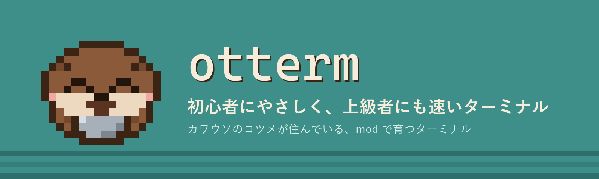
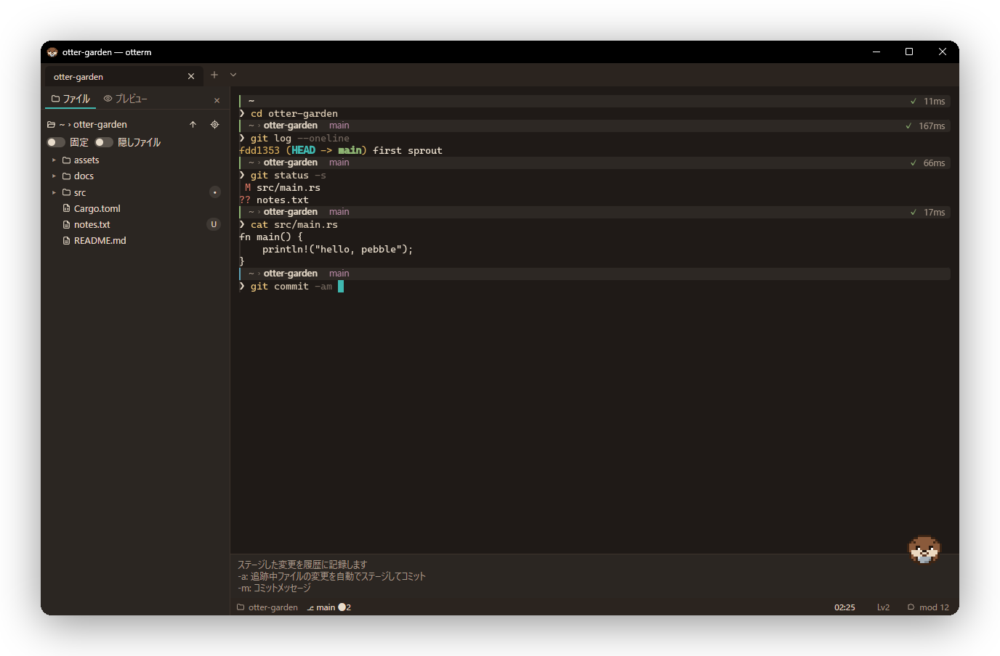
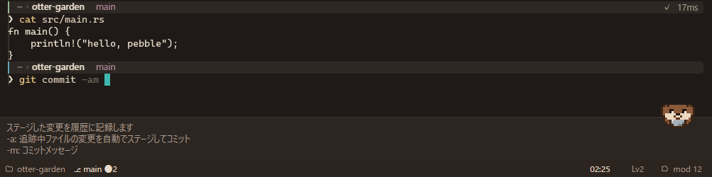
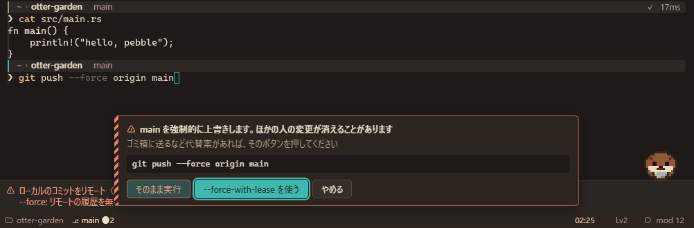
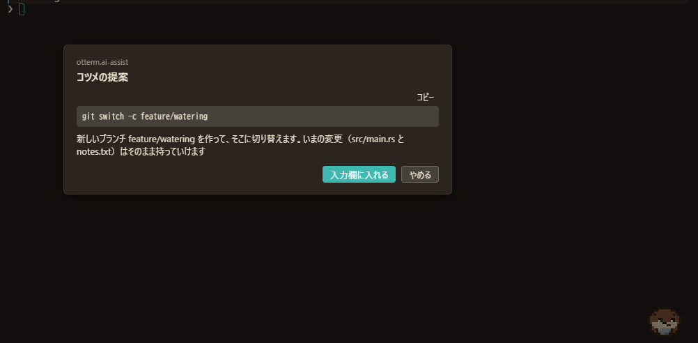
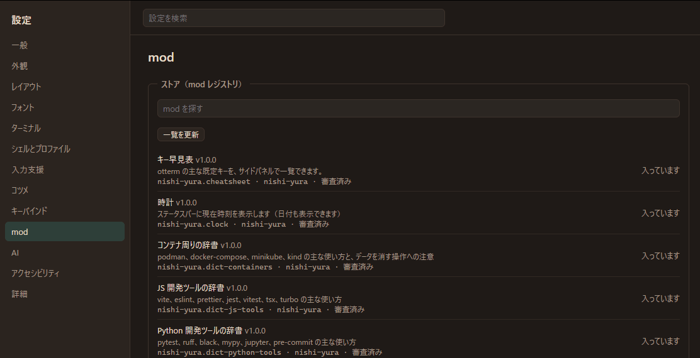
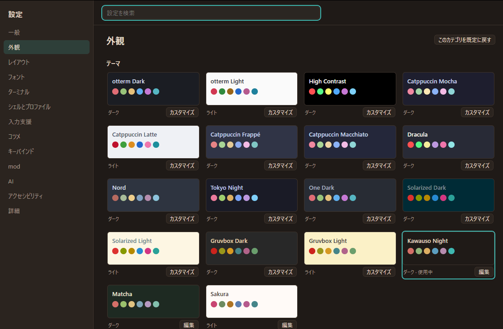
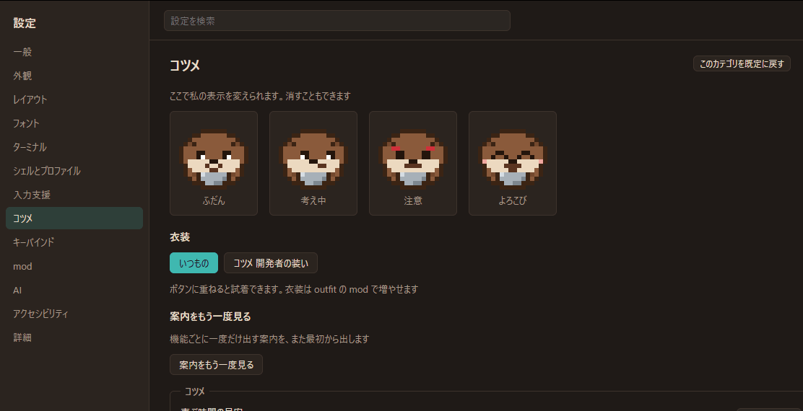
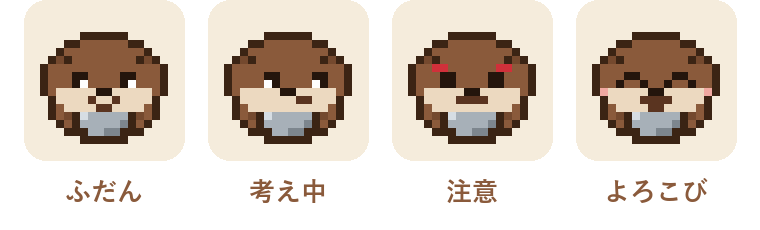

<div align="center">

<a href="README.en.md">English</a> ・ <b>日本語</b>



<br>

<a href="https://github.com/Nishi-Yura/Otterm/releases/latest"></a>
<a href="LICENSE"></a>

<br>


<h3>黒い画面を、親切なアプリに。<br>毎日使う人には、軽くて速くて、好きなだけ改造できる道具に。</h3>

<a href="#-インストール"><b>インストール</b></a> ・
<a href="#-特徴"><b>特徴</b></a> ・
<a href="#-コツメ"><b>コツメ</b></a> ・
<a href="#-mod"><b>mod</b></a> ・
<a href="#-性能"><b>性能</b></a> ・
<a href="#-ドキュメント"><b>ドキュメント</b></a>

<br><br>

<picture>
  <source media="(prefers-color-scheme: light)" srcset="assets/readme/shot-light.png">
  
</picture>

<sub>テーマ「カワウソの夜」（ライトモードで見ると「さくら」）。右下にいるのがコツメ。</sub>

</div>

<br>

## 🦦 otterm って？

名前は **otter（カワウソ）+ term**。カワウソが器用な前足で貝（shell）をこじ開けるように、otterm はシェルを解きほぐして、使う人のそばに寄り添います。

- 初めての人には、打っているコマンドの意味を**打ちながら**説明し、危ないコマンドは**実行前に止めて**、何が起きるかを日本語で見せます。
- 毎日使う人には、案内を**レベル 0** にすれば何も出しゃばらない速いターミナルに。GPU 描画、ブロック、分割、検索、Kitty キーボードまで揃っています。
- そして**ゲームの mod のように**、1 つ入れるだけで機能や見た目が足されます。標準機能も同じ mod API で作られています。

> [!NOTE]
> otterm はコマンドを**勝手に実行しません**。提案は入力欄に入るだけで、Enter を押すのはいつもあなたです。

<br>

## ✨ 特徴

<table>
<tr>
<td width="50%" valign="top">

### 🧭 打ちながら分かる
入力中のコマンドを辞書（同梱 **164 コマンド**、mod で追加可）で読み解き、オプションの意味を入力欄の上に出します。PowerShell の `Verb-Noun` も、`git` のサブコマンドも。

</td>
<td width="50%" valign="top">



</td>
</tr>
<tr>
<td width="50%" valign="top">



</td>
<td width="50%" valign="top">

### 🛑 危ないコマンドの前で止まる
`rm -rf`、`git push --force`、`docker volume prune`……。実行の直前に、**何が消えるか**と**安全な代わり方**を見せて確認します。案内レベルで強さを調整できます。

</td>
</tr>
<tr>
<td width="50%" valign="top">

### 🤖 コツメに聞く（AI・任意）
既定ではオフ。Ollama などのローカルモデルか、自分のキー（Claude / OpenAI / Gemini / 互換 API）で。**送る前に中身を見せ**、トークンやパスワードらしき文字列は伏せます。返ってきたコマンドは入力欄に入るだけ。

</td>
<td width="50%" valign="top">



</td>
</tr>
<tr>
<td width="50%" valign="top">



</td>
<td width="50%" valign="top">

### 🧩 mod ストア
テーマ、ステータスバー、時計、ポモドーロ、チートシート、辞書の追加……。設定画面から入れて、その場で有効に。mod は**権限を宣言**し、サンドボックスで動き、ターミナルを落とせません。

</td>
</tr>
</table>

<details>
<summary><b>そのほかにできること（クリックで開く）</b></summary>

<br>

| | |
| --- | --- |
| 🧱 **ブロック** | シェル統合（OSC 133）で、コマンドごとに折りたたみ・再実行・出力のコピー・ジャンプ。pwsh / bash / zsh / fish |
| 🪟 **タブと分割** | タブ、縦横の分割、ワークスペース（`.otterm/` でプロジェクトごとの設定とタブ。信頼したものだけ） |
| 🔎 **検索とスクロールバック** | 古い行は LZ4 で圧縮して保持。無制限にするとディスクへ退避し、検索もそのまま届く |
| 🔗 **リンク** | URL とファイルパスを Ctrl+クリック。ファイルのドラッグ&ドロップでパスを入力 |
| 🈁 **日本語** | IME、全角幅、合字、絵文字。UI とコツメの台詞は日本語と英語 |
| 🎨 **テーマ** | 同梱 15 種＋mod。iTerm2 / Windows Terminal / VS Code / Alacritty / WezTerm の配色を取り込み。背景画像、透過、ぼかし |
| ⌨️ **キーバインド** | 連続キー、`when` 条件、コマンドパレット、設定画面で押して登録 |
| ⚙️ **設定** | `config.toml` と設定画面は同じもの。どちらで変えてもすぐ反映 |
| 🔄 **更新** | 署名つきの自動更新（確認は任意）。ローカルのクラッシュログから「Issue を作る」 |
| 🛡️ **プライバシー** | テレメトリなし、サーバーなし、アカウントなし |

</details>

<p align="center">
  
  
</p>
<p align="center"><sub>同梱 15 テーマ＋mod ・ コツメの表情と衣装（ボタンに重ねると試着）</sub></p>

<br>

## 🦦 コツメ


画面の中には、コツメカワウソの **コツメ**（海外名 **Pebble**）が住んでいます。

- 長いコマンドの間は**考え中**、うまくいったら**よろこび**、危ないときは**注意**。あなたの作業に合わせて表情が変わります。
- 初めての操作のときだけ、短くひとこと。同じことは二度言いません。
- 着せ替え mod で見た目を変えられます（同梱: 開発者セット 👓☕）。
- じゃまなら、設定ひとつで完全に隠れます。

<br clear="right">

<p align="center">
  
</p>

<br>

## 🧩 mod

```toml
# otmod.toml — これだけで 1 つの mod
[mod]
id = "you.hello"
name = "Hello"
version = "1.0.0"
kind = "extension"

[compat]
api = "1"

[entry]
main = "dist/main.js"

[[adds]]
slot = "statusbar.right"
label = "あいさつ"
```

```ts
// src/main.ts
import type { ModContext } from "@otterm/api";

export async function activate(ctx: ModContext) {
  ctx.ui.slot("statusbar.right").add({ type: "text", text: "🦦 hello" });
}
```

- **型つきの API**（[`@otterm/api`](packages/api/)、MIT）とテンプレート（[`packages/create-mod`](packages/create-mod/)）
- **権限は宣言制**。ファイル、ネットワーク、ターミナルへの書き込み、AI などを使うときは、入れる前にユーザーに見せます
- **QuickJS のサンドボックス**で動くので、mod が固まってもターミナルは止まりません
- 公開は [registry/](registry/README.md) へのプルリクエストで。お金はかかりません

| ストアにある mod | |
| --- | --- |
| 🎨 テーマ | カワウソの夜 / さくら / 抹茶 |
| 📊 ステータスバー | Git ステータス、時計、ポモドーロ |
| 📚 辞書 | コンテナ、JavaScript ツール、Python ツール |
| 🔔 そのほか | チートシート、長いコマンドの完了通知 |

<br>

## ⚡ 性能

キーを押してから画面に文字が出るまでを、毎回ベンチマークで測っています（[docs/bench](docs/bench/baseline.md)、開発機 Ryzen 7 3700X・Windows）。

| 指標 | 値 |
| --- | --- |
| ⌨️ 打鍵遅延 p99（WebGL2） | **6.2 ms**（1 フレーム 16.7 ms の半分以下） |
| 🚀 起動からプロンプトまで（中央値） | **694 ms** |
| 📜 VT 解析 | **62 MiB/s** |
| 🧠 スクロールバック | 古い行は LZ4 で圧縮。メモリは 32 MB まで |

キー入力は mod を待たずに Rust へ直行します。描画は WebGL2（使えないときは Canvas 2D）、グリフは Rust でラスタライズしてテクスチャにまとめます。

<br>

## 📦 インストール

v1.0 は **Windows（x64）版**です。macOS / Linux 版は実機で確かめてから 1.0.x で出します。それまではソースからビルドしてください。

| OS | 入れ方 |
| --- | --- |
| 🪟 **Windows** | [Releases](https://github.com/Nishi-Yura/Otterm/releases/latest) の `otterm_<version>_x64-setup.exe` を実行（ユーザー単位、管理者権限は不要）。新しいターミナルで `otterm` と打てば起動します。winget（`winget install otterm`）は申請中 |
| 🍎 **macOS** | 1.0.x で `.dmg` と Homebrew の tap（`brew install --cask nishi-yura/otterm/otterm`）。いまはソースから |
| 🐧 **Linux** | 1.0.x で `.AppImage`。いまはソースから |

> [!NOTE]
> インストーラーにコード署名はありません（有料のため）。Windows では SmartScreen の「詳細情報 → 実行」が要ります。ファイルが本物かは、Releases に添えた `SHA256SUMS.txt` で確かめられます。自動更新は署名つきで、確認するかどうかは初回の案内で聞かれます。

**ソースから**:

```bash
git clone https://github.com/Nishi-Yura/Otterm.git
cd Otterm
just setup   # JS の依存と、Windows では同梱する ConPTY
just dev     # ホットリロードで起動
```

Rust（stable）、Node.js 22 以上、pnpm、[just](https://github.com/casey/just) が要ります。Linux では [Tauri の前提条件](https://v2.tauri.app/start/prerequisites/)も。インストーラーを作るには `node scripts/release.mjs`（[docs/release.md](docs/release.md)）。

<br>

## 🗺️ ロードマップ

| | マイルストーン | |
| :-: | --- | --- |
| ✅ | M0 土台 | モノレポ、ベンチ、CI |
| ✅ | M1 ターミナルとして成立 | VT、タブと分割、検索、IME、WebGL2 |
| ✅ | M2 シェル統合とブロック | OSC 133、ブロック、プロンプトバー |
| ✅ | M3 mod システム | マニフェスト、権限、サンドボックス |
| ✅ | M4 入力補助 | 辞書、説明、危険ガード、補完 |
| ✅ | M4.5 コツメ | 表情、台詞、着せ替え |
| ✅ | M5 設定とテーマ | 設定画面、キーバインド、ワークスペース |
| ✅ | M5.5 AI 補助 | ローカル / 自分のキー、送信プレビュー |
| ✅ | M6 配布 | インストーラー、署名つき自動更新、ストア、ドキュメントサイト |
| ✅ | v1.0 | Windows 版を公開 |
| ⏳ | v1.0.x | macOS / Linux 版、winget / Homebrew、参照マシンでの計測 |

詳しくは [docs/07-roadmap.md](docs/07-roadmap.md)。

<br>

## 📚 ドキュメント

使い方のガイドは [site/](site/) にあります（Starlight。まだホストしていないので、GitHub 上でそのまま読むか、`pnpm --filter @otterm/site dev` で手元に開きます）。

- 🧭 [ユーザーガイド](site/src/content/docs/guide/getting-started.md): インストール、基本操作、入力補助、設定、キーバインド、テーマ、コツメ、困ったとき
- 🧩 [mod 作者ガイド](site/src/content/docs/mods/index.md): 作り方、マニフェスト、権限、API、パッケージ化、公開

仕様書は日本語が正です。

| | ファイル | 内容 |
| --- | --- | --- |
| 🌱 | [00-overview](docs/00-overview.md) | コンセプト、ターゲット、やらないこと |
| 📋 | [01-requirements](docs/01-requirements.md) | 機能要件、非機能要件 |
| 🏗️ | [02-architecture](docs/02-architecture.md) | 技術スタック、プロセス構成 |
| 🧰 | [03-core-features](docs/03-core-features.md) | PTY、入力補助、ファイル操作、パレット |
| 🎨 | [04-ui-theme](docs/04-ui-theme.md) | UI 構成、テーマ |
| 🧩 | [05-mod-system](docs/05-mod-system.md) | マニフェスト、API、権限、配布 |
| ⚙️ | [06-config-keybind](docs/06-config-keybind.md) | 設定ファイル、キーバインド |
| 🗺️ | [07-roadmap](docs/07-roadmap.md) | マイルストーン |
| 🦦 | [08-character](docs/08-character.md) | コツメ（デザイン、表情、着せ替え） |
| ⚡ | [09-performance](docs/09-performance.md) | 遅延の予算、レンダラ、ベンチ |
| 🤖 | [10-ai-assist](docs/10-ai-assist.md) | AI 補助、送信内容の扱い |
| 🧭 | [11-decisions](docs/11-decisions.md) | 判断の記録 |
| 🎛️ | [12-design-system](docs/12-design-system.md) | UI トークン、文字、アイコン |

<br>

## 🤝 参加する

Issue もプルリクエストも歓迎です。始める前に [CONTRIBUTING.md](CONTRIBUTING.md) を。コード、コメント、コミットメッセージ、Issue は英語でお願いします（仕様書は日本語）。

<br>

## 📄 ライセンス

- 本体: [Apache-2.0](LICENSE)
- mod SDK（`@otterm/api`）: MIT
- コツメの画像: キャラクターガイドライン（[assets/mascot/LICENSE.md](assets/mascot/LICENSE.md)）

<br>

<div align="center">

<br>
<sub>テレメトリなし・サーバーなし・アカウントなし。あなたのターミナルは、あなたのもの。</sub>
</div>
