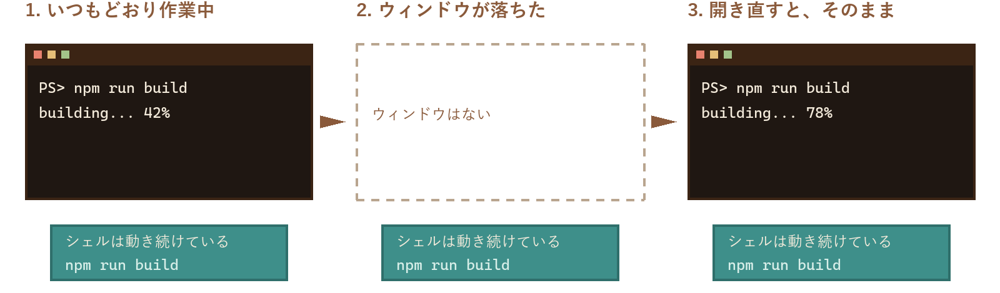

<div align="center">

<a href="README.en.md">English</a> ・ <b>日本語</b>


<a href="https://github.com/Nishi-Yura/Otterm/releases/latest"></a>
<a href="LICENSE"></a>


<br>

[インストール](#インストール) ・ [otterm の強み](#otterm-の強み) ・ [mod](#mod-で足していく) ・ [コツメ](#コツメ) ・ [性能](#性能) ・ [ドキュメント](#ドキュメント)

<br>

<picture>
  <source media="(prefers-color-scheme: light)" srcset="assets/readme/shot-light.png">
  
</picture>

<sub>テーマは「カワウソの夜」（GitHub をライトモードで見ると「さくら」）。右下にいるのがコツメ。どちらも mod です。</sub>

</div>

<br>

## otterm について

Rust と Tauri で作っているターミナルです。いまは Windows 版を出していて、macOS と Linux は実機で確かめてから出します。

名前は otter（カワウソ）と term から。カワウソは石で貝を割って食べるので、shell を割るターミナル、という洒落です。

入れたばかりの otterm は、何も足していない普通のターミナルです。そこから、ほしいものだけを足していきます。

> [!NOTE]
> otterm はコマンドを勝手に実行しません。提案は入力欄に入るだけで、Enter を押すのはあなたです。

<br>

## otterm の強み

### シェルは、ウィンドウより長生き

シェルは otterm のウィンドウとは別のプロセスで動いています。otterm が落ちても、更新や設定の反映で再起動しても、ビルドやサーバーは止まらず、スクロールバックもそのまま。次に開いたウィンドウが同じタブを開き直します。Windows でも tmux はいりません。

<p align="center">
  
</p>

### 足すものは、自分で選ぶ

コツメも、打ちながらの説明も、ファイルツリーも mod です。最初はどれもオフなので、使わないものに邪魔されません。mod はファイル、ネットワーク、ターミナルへの書き込み、AI のうち何を使うかを宣言し、入れる前にそれが見えます。サンドボックスの中で動くので、mod が固まってもターミナルは止まりません。

### 日本語で、最初から

画面、コツメの台詞、コマンドの辞書は、日本語と英語で用意しています。変換中の文字はカーソルの位置に出て、Claude Code のように自分でカーソルを描くアプリでも、変換候補が離れた場所に出ません。全角の幅と、曖昧な幅の文字の扱いも選べます。

### 外に出すものは、見せてから

アカウントもテレメトリもありません。AI に聞く機能は使う人だけがオンにするもので、送る前に毎回中身を見せ、トークンやパスワードに見える文字列は伏せます。

### 数字は、測り方ごと

打鍵の遅れや処理速度は、測った手順と一緒に載せています。速くないところも隠しません（[性能](#性能)）。

まだできないこともあります。画像の表示（sixel、kitty の画像プロトコル）と、macOS と Linux の版はこれからです。

<br>

## mod で足していく

ステータスバーの「mod」で開く mod の画面から、ほしいものをオンにします。「おすすめをまとめてオンにする」を押すと、コツメ、辞書、説明、補完、危険ガード、エラー助言、履歴検索、ファイルツリーが一度に入ります。

<table>
<tr>
<td width="50%" valign="top">

</td>
<td width="50%" valign="top">

### 打ちながら分かる

入力中のコマンドを同梱の辞書（164 コマンド）で読み、オプションの意味を入力欄の上に出します。PowerShell の `Verb-Noun` も、`git` のサブコマンドも引けます。辞書は mod で増やせます。

</td>
</tr>
<tr>
<td width="50%" valign="top">

### 危ないコマンドの前で止まる

`rm -rf`、`git push --force`、`docker volume prune`。実行する直前に、何が消えるかと、安全な代わりの打ち方を出して確かめます。止める強さはガイドレベルで変わります。

</td>
<td width="50%" valign="top">

</td>
</tr>
<tr>
<td width="50%" valign="top">

</td>
<td width="50%" valign="top">

### AI に聞く（使う人だけ）

初期設定はオフです。Ollama などのローカルモデルか、自分の API キー（Claude、OpenAI、Gemini、互換 API）を使います。送る前に中身を毎回見せ、トークンやパスワードに見える文字列は伏せます。返ってきたコマンドは入力欄に入るだけです。

</td>
</tr>
</table>

ストアには、ほかの人が作った mod もあります。

| 種類 | いまストアにあるもの |
| --- | --- |
| テーマ | カワウソの夜、さくら、抹茶、雪、夕焼け、深海 |
| ステータスバー | Git の状態、時計、ポモドーロ、終了コードと実行時間 |
| パネル | プロジェクトのスクリプト（package.json、justfile、Makefile）、フォルダのしおり、コマンドの統計、キーの早見表 |
| 辞書 | コンテナ、JavaScript と Python のツール、ネットワーク、データベース、モダンな CLI、動画と画像の変換 |
| コツメ | 冬支度（ニット帽とミトン）、今日のコマンド |
| そのほか | 長いコマンドが終わったら知らせる |

<details>
<summary><b>mod を作る</b></summary>

<br>

`otmod.toml` と JavaScript が 1 つあれば mod になります。

```toml
# otmod.toml
[mod]
id = "you.hello"
name = "Hello"
version = "1.0.0"
author = "you"
kind = "extension"

[compat]
otterm = ">=1.0.0 <2.0.0"
api = "1"

[entry]
main = "dist/main.js"

[[adds]]
slot = "statusbar.right"
label = "あいさつ"
```

```ts
// src/main.ts
import type { ModContext } from "@otterm/api";

export async function activate(ctx: ModContext) {
  ctx.ui.slot("statusbar.right").add({ type: "text", text: "hello" });
}
```

- API には型があります（[`@otterm/api`](packages/api/)、MIT）。テンプレートは [`packages/create-mod`](packages/create-mod/)。
- ファイル、ネットワーク、ターミナルへの書き込み、AI を使う mod は、入れる前にそのことをユーザーに見せます。
- mod は QuickJS のサンドボックスで動くので、mod が固まってもターミナルは止まりません。
- ストアへの公開は [registry/](registry/README.md) へのプルリクエストです。お金はかかりません。

</details>

<br>

## コツメ


コツメカワウソの「コツメ」（海外では Pebble）が、画面の隅にいます。長いコマンドの間は考え込み、うまくいくと喜び、危ないときは顔を曇らせます。初めて何かをしたときだけ、短くひとこと言います。同じことは二度言いません。

ドット絵は 16×16 のマス目に手で置いたものです。着せ替えも mod で、同梱しているのはメガネとマグカップの開発者セット。コツメ自体も mod（`otterm.mascot`）なので、オンにしたときだけ現れます。

<br clear="right">

<p align="center">
  
</p>

<br>

## そのほかにできること

| | |
| --- | --- |
| ブロック | シェル統合（OSC 133）で、コマンドごとに折りたたみ、もう一度実行、出力のコピー、前後へのジャンプ。pwsh、bash、zsh、fish |
| タブと分割 | タブ、縦横の分割、ワークスペース（`.otterm/` でプロジェクトごとの設定とタブ。信頼したものだけ） |
| 検索とスクロールバック | 古い行は LZ4 で圧縮して持つ。無制限にするとディスクに逃がし、検索はそこまで届く |
| リンク | URL とファイルパスを Ctrl+クリック。ファイルをドラッグ&ドロップするとパスが入る |
| 日本語 | IME、全角の幅、合字、絵文字。画面とコツメの台詞は日本語と英語 |
| テーマ | 同梱 15 種と mod。iTerm2、Windows Terminal、VS Code、Alacritty、WezTerm の配色を取り込める |
| キーバインド | 連続キー、`when` 条件、コマンドパレット、設定画面でキーを押して登録 |
| 設定 | `config.toml` と設定画面は同じもの。どちらで変えてもすぐ反映 |
| 更新 | 署名つきの自動更新（確認するかは選べる）。クラッシュしたら、次の起動で「Issue を作る」 |

<br>

## 性能

打鍵の遅れと処理速度を、毎回同じ手順で測っています（[docs/bench](docs/bench/baseline.md)、開発機は Ryzen 7 3700X と Windows 11）。勝っていないところも載せます。

| 指標 | 値 | 補足 |
| --- | --- | --- |
| キーを押してから描画まで（p99） | 6.2 ms | WebView の中で測った値。画面に光が出るまでの実測（カメラ）はまだ |
| 起動してプロンプトが出るまで（中央値） | 694 ms | うち約 380 ms は WebView2 の起動 |
| VT の解析（スクロールする出力） | 約 70〜80 MiB/s | 1.1 は約 30。Windows では PTY（約 30〜35 MiB/s）のほうが先に上限になる |
| スクロールバック 100 万行 | 約 155 MiB | 1 行あたり 160 バイトほど |
| 待機中のメモリ（タブ 1 つ、ワーキングセット合計） | 約 460〜480 MB | otterm 本体 約 90 MB、WebView2 の 6 プロセス 約 350 MB。Tauri の代償で、Alacritty や Windows Terminal より重い |

キー入力は mod を待たずに Rust へ届きます。描画は WebGL2（使えないときは Canvas 2D）で、文字の形は Rust で整えてからテクスチャにまとめます。

<br>

## インストール

| OS | 入れ方 |
| --- | --- |
| Windows | [Releases](https://github.com/Nishi-Yura/Otterm/releases/latest) の `otterm_<version>_x64-setup.exe` を実行します（ユーザー単位、管理者権限はいりません）。新しいターミナルで `otterm` と打つと起動します。winget は申請中です |
| macOS | 準備中です。いまはソースからビルドしてください |
| Linux | 準備中です。いまはソースからビルドしてください |

> [!NOTE]
> インストーラにはコード署名がありません（証明書が有料のため）。Windows では SmartScreen が出るので「詳細情報」から「実行」を選んでください。ファイルが本物かは、Releases に置いた `SHA256SUMS.txt` で確かめられます。自動更新のほうは署名を確かめています。

<details>
<summary><b>ソースからビルドする</b></summary>

<br>

```bash
git clone https://github.com/Nishi-Yura/Otterm.git
cd Otterm
just setup   # JS の依存と、Windows では同梱する ConPTY
just dev     # ホットリロードで起動
```

Rust（stable）、Node.js 22 以上、pnpm、[just](https://github.com/casey/just) が必要です。Linux では [Tauri の前提条件](https://v2.tauri.app/start/prerequisites/)も入れてください。インストーラを作るときは `node scripts/release.mjs`（[docs/release.md](docs/release.md)）。

</details>

<br>

## これまでとこれから

1.0（2026 年 10 月）で、ターミナルとして使えるところまでを出しました。VT、タブと分割、シェル統合、mod、辞書と危険ガード、設定画面、配布の仕組みです。1.1 で最初は何も足さない形にし、1.2 でシェルをウィンドウとは別のプロセスに移しました。

次にやること:

- 画面の更新を軽くする（フレームに「n 行スクロール」を足し、描画は新しい行だけ作る）
- 画像の表示（sixel、kitty の画像プロトコル）
- macOS と Linux の版、winget と Homebrew
- 打鍵の遅れを、画面に出るところまでカメラで測る

詳しくは [docs/07-roadmap.md](docs/07-roadmap.md)。

<br>

## ドキュメント

使い方のガイドは [site/](site/) にあります（まだどこにも公開していないので、GitHub で直接読むか、`pnpm --filter @otterm/site dev` で手元に開いてください）。

- [ユーザーガイド](site/src/content/docs/guide/getting-started.md): インストール、基本操作、入力の手助け、設定、キーバインド、テーマ、コツメ、困ったとき
- [mod 作者ガイド](site/src/content/docs/mods/index.md): 作り方、マニフェスト、権限、API、パッケージ、公開

仕様書は日本語が正本です。

| ファイル | 内容 |
| --- | --- |
| [00-overview](docs/00-overview.md) | 考え方、誰のためか、やらないこと |
| [01-requirements](docs/01-requirements.md) | 機能と非機能の要件 |
| [02-architecture](docs/02-architecture.md) | 技術の選び方、プロセスの構成 |
| [03-core-features](docs/03-core-features.md) | PTY、入力の手助け、ファイル操作、パレット |
| [04-ui-theme](docs/04-ui-theme.md) | 画面の構成、テーマ |
| [05-mod-system](docs/05-mod-system.md) | マニフェスト、API、権限、配布 |
| [06-config-keybind](docs/06-config-keybind.md) | 設定ファイル、キーバインド |
| [07-roadmap](docs/07-roadmap.md) | マイルストーン |
| [08-character](docs/08-character.md) | コツメ（デザイン、表情、着せ替え） |
| [09-performance](docs/09-performance.md) | 遅延の予算、描画、ベンチマーク |
| [10-ai-assist](docs/10-ai-assist.md) | AI に聞く機能と、送る内容の扱い |
| [11-decisions](docs/11-decisions.md) | 決めたことの記録 |
| [12-design-system](docs/12-design-system.md) | 画面の部品、文字、アイコン |
| [13-positioning](docs/13-positioning.md) | otterm が大事にしていることと、そのための調査 |

<br>

## 参加する

Issue もプルリクエストも歓迎です。始める前に [CONTRIBUTING.md](CONTRIBUTING.md) を読んでください。コード、コメント、コミットメッセージ、Issue は英語でお願いします（仕様書は日本語です）。

## ライセンス

- 本体: [Apache-2.0](LICENSE)
- mod の SDK（`@otterm/api`）: MIT
- コツメの画像: キャラクターガイドライン（[assets/mascot/LICENSE.md](assets/mascot/LICENSE.md)）

<br>

<div align="center">

<br>
<sub>アカウントもサーバーもテレメトリもありません。外と通信するのは、オンにした更新の確認、開いたときのストア、自分で設定した AI、ネットワークを許可した mod だけです。</sub>
</div>
